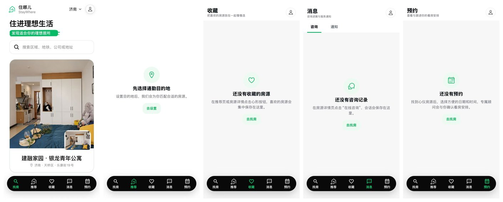
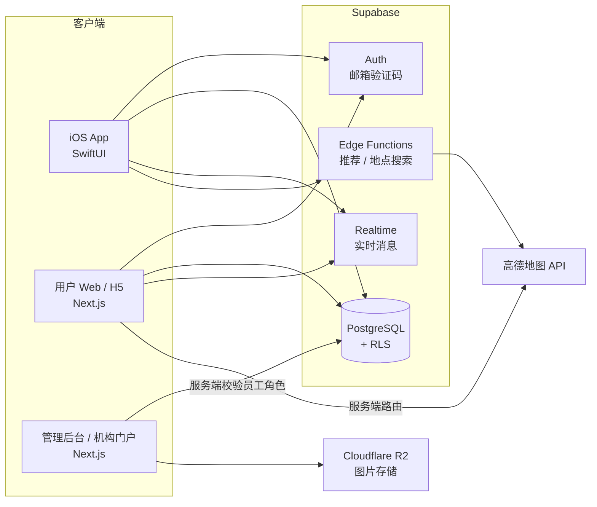
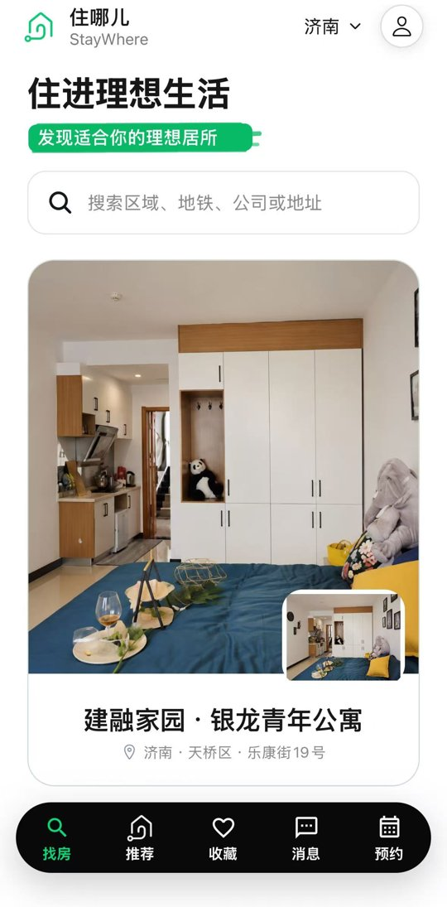
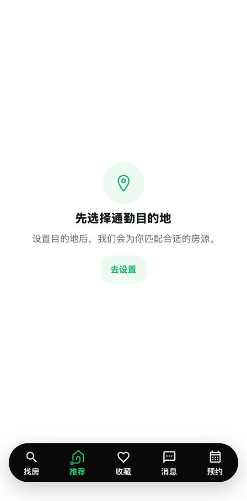
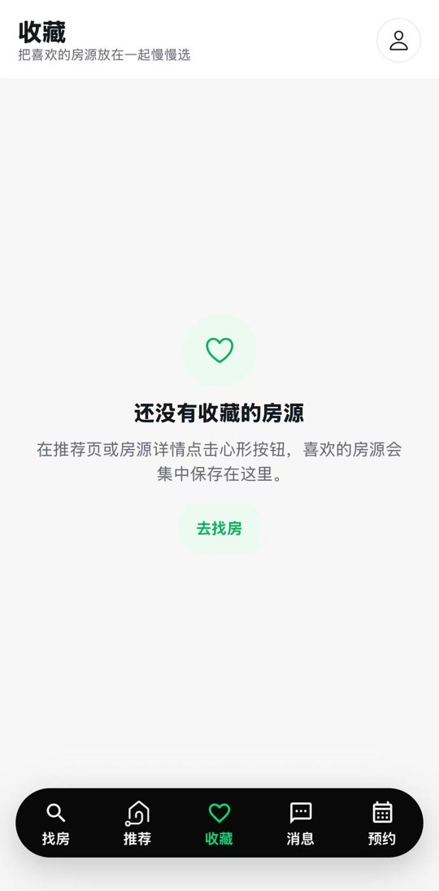
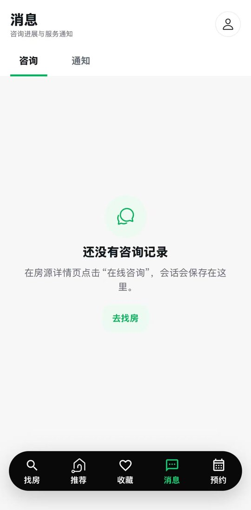
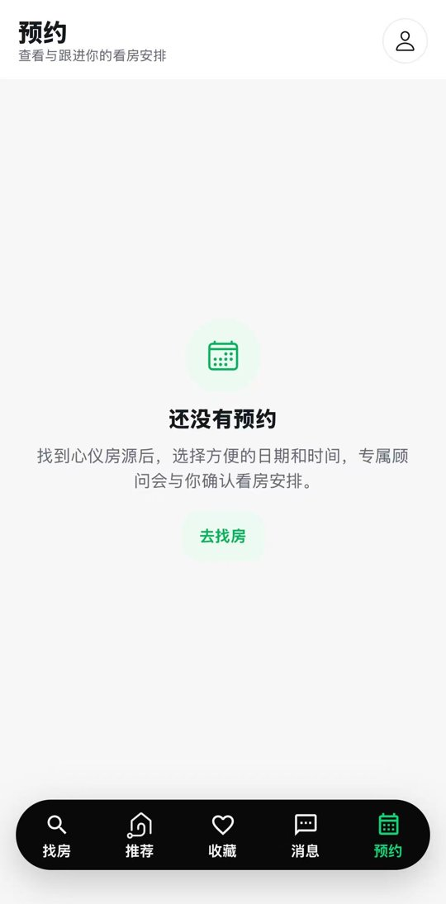

# 住哪儿 StayWhere · 青年租房发现与预约平台

> 面向实习短租、人才公寓与青年公寓人群的垂直租房平台。首个服务城市为济南，Web/H5 与 iOS App 均已上线（iOS 已上架 App Store）。
>
> A vertical rental discovery & booking platform for interns and young professionals in China. Web/H5 and native iOS app are live (iOS on the App Store).

**官网：** 【待填：官网链接】 · **App Store：** 【待填：App Store 链接】

---

## 我的角色

**产品与开发负责人**（两人团队，2026.06 – 至今）

- 本人负责产品定义与全部技术实现：需求、范围、数据模型、Web/H5、管理后台、iOS App、部署上线。
- 合作伙伴负责公寓线下对接。双方共同设计商业模式与合作流程。

> 本仓库为项目展示仓库，只包含项目说明、架构设计与截图，不包含源代码。

---

## 为什么做这个产品

人才公寓、青年公寓和商业公寓的信息分散在独立 App、公众号、小程序和线下渠道里。目标用户在找房时主要遇到三个问题：

| 痛点 | 现状 | StayWhere 的做法 |
|---|---|---|
| 房源分散 | 要在多个平台之间来回切换 | 集中整理一个城市的精选公寓 |
| 租期和价格不透明 | 最短租期、短租价格要逐个咨询 | 结构化展示租期、入住时间与费用 |
| 查通勤效率低 | 复制地址，打开地图 App，再切回来 | 推荐、列表、详情中直接给出通勤结果 |

**定位：** 精选房源 + 租期透明 + 通勤一体化。核心价值是缩短用户搜索、比较和做决定的时间，而不是房源数量最多。

---

## 核心功能

### iOS App（SwiftUI）
- **找房：** 关键词搜索（区域、地铁、公司、地址），以及类社交 App 的左右滑动匹配房源
- **推荐：** 根据通勤目的地、通勤方式、预算、租期等需求匹配房源
- **收藏：** 收藏喜欢的房源，集中比较
- **消息：** 在线咨询会话与服务通知
- **预约：** 选择日期和时间预约看房，跟进预约状态

### 用户 Web / H5（Next.js）
- 邮箱验证码登录；游客无需登录即可浏览公开房源
- 找房需求卡片、房源列表与详情、收藏、房源对比
- 通勤推荐与单房源通勤详情
- 预约创建、查看与取消；会话与消息
- 行为埋点与留资（联系方式等敏感信息不进入普通埋点）

### 管理后台（Next.js）
- 员工登录，区分 admin / operator / support 三种角色权限
- 公寓、房型的创建、编辑与上下架；图片上传、设置封面与删除（Cloudflare R2）
- 预约列表、状态流转与内部备注
- 会话工作台：查看用户消息并以员工身份回复
- 机构门户：公寓机构账号（agency_owner / agency_agent）只能管理自己机构的房源、预约与会话；房源提交后需平台审核

---

## 技术栈

| 层 | 技术 |
|---|---|
| iOS | SwiftUI（iOS 17）、XcodeGen、XCTest |
| Web / 管理后台 | Next.js 14、React 18、TypeScript、Tailwind CSS |
| 后端与数据 | Supabase：PostgreSQL、Auth（邮箱验证码）、行级权限 RLS、Realtime、Edge Functions（Deno / TypeScript） |
| 第三方服务 | 高德地图 Web 服务 API（地点搜索、通勤计算）、Cloudflare R2（图片存储，S3 SDK） |

---

## 系统架构

---

## 关键设计

### 1. 用 RLS 在数据库层做权限隔离
- 15 张业务表全部启用行级权限，约 50 条 RLS 策略。
- 公开客户端只能读取**已发布**的公寓、**可用**的房型和**有效**的图片；收藏、预约、会话等私有数据按 `auth.uid()` 隔离。
- 员工分 admin / operator / support 三种角色；机构账号通过 `agency_id` 只能访问自己机构的数据，房源带审核状态（`review_status`）。
- Service Role 密钥、R2 密钥、高德服务端 Key 只放在服务端，不暴露给客户端。

### 2. 通勤计算：缓存优先、只算候选、失败降级
- 先查 `commute_cache` 通勤缓存，未命中再调用高德接口。
- 只对通过筛选的**候选房源**做精确通勤计算，不对全部公寓同步计算，以控制第三方 API 成本和延迟。
- 高德接口失败时推荐结果照常返回，通勤显示为“计算失败 / 估算”，不阻断用户浏览。
- 浏览器端无法直接读取通勤缓存视图，返回数据不包含高德原始响应。

### 3. 上线前的安全与性能检查
- 部署前完成安全审计：修复了“部分管理页面只校验员工身份、未校验角色”的问题，为两个 Next.js 应用补充安全响应头，撤销公开角色对通勤缓存视图的直接读取权限。
- 列表查询设置数量上限，主要读取路径建立索引，图片延迟加载并提供失败占位；另外制定了轻量负载测试方案和 Staging 部署手册。

### 4. 用决策记录管理产品范围
- 用 `DECISIONS.md` 管理 15 项已确认决策和 5 项待确认问题，例如“V1 只服务济南”“实时聊天、房源对比、地图找房为 V1 必须功能”“早期房源由团队人工采集”等。
- 明确 V1 不做在线支付、电子签约、多城市切换等功能，防止范围膨胀。

### 5. AI 辅助开发规范
- 采用 AI 编程工具辅助开发，并通过 `AGENTS.md`、文档入口和“每个任务只读取最小必要上下文”的规则约束 AI 协作，减少错误引用和返工。

---

## 数据模型（15 张表）

| 领域 | 表 |
|---|---|
| 用户与需求 | `users`、`search_cards` |
| 房源 | `apartments`、`room_types`、`apartment_images` |
| 用户行为 | `favorites`、`appointments` |
| 咨询 | `conversations`、`conversation_apartments`、`messages` |
| 运营与权限 | `staff_users`、`agencies` |
| 通勤 | `commute_cache` |
| 增长 | `analytics_events`、`leads` |

---

## 项目现状

- 首个服务城市：济南
- Web/H5 与 iOS App 均已上线，iOS 版已上架 App Store
- 已录入 40 余家公寓，并与公寓方签约上架房源；已有真实用户使用，正在根据反馈持续迭代

---

## 截图

| 找房 | 推荐 | 收藏 | 消息 | 预约 |
|---|---|---|---|---|
|  |  |  |  |  |
